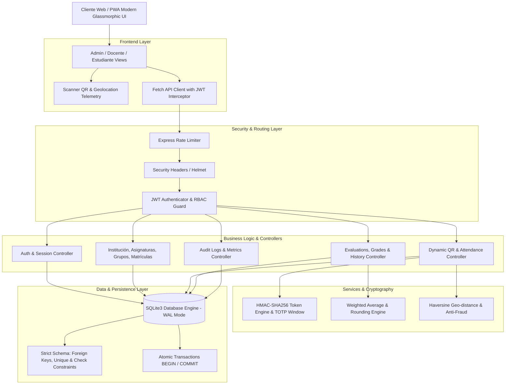
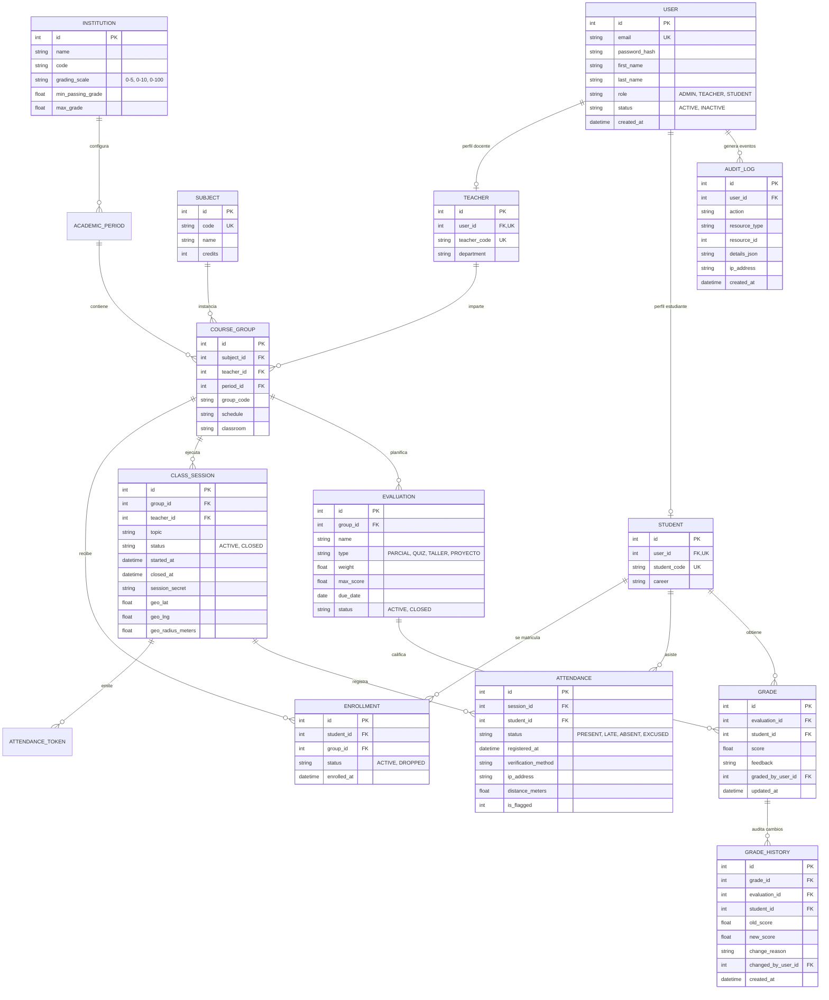
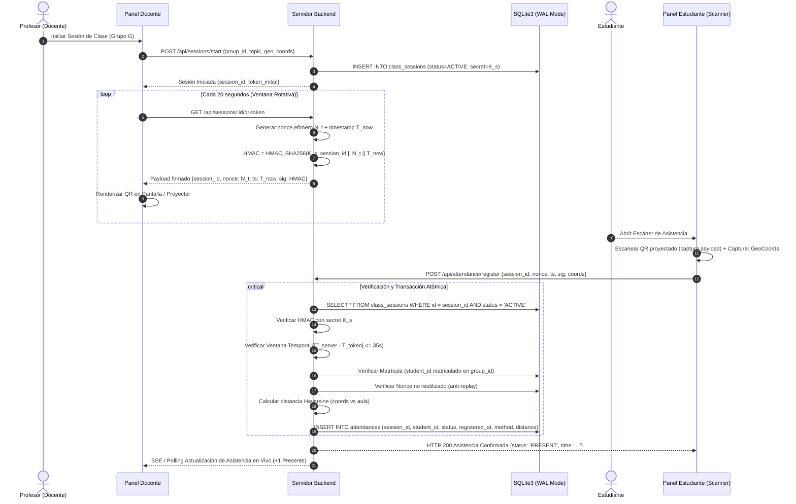

# ARCHITECTURE — PLATAFORMA ACADÉMICA INTEGRAL (NexusAcademic)

**Fecha:** 2026-09-03  
**Versión:** 1.0.0

---

## 1. Visión General de la Arquitectura

La plataforma sigue una arquitectura en capas desacopladas (**Layered Architecture / Clean Architecture**) con separación clara de responsabilidades:

---

## 2. Modelo Relacional de Base de Datos (E-R)

---

## 3. Protocolo de Asistencia con QR Criptográfico Dinámico

---

## 4. Principios de Seguridad y Aislamiento

1. **Defensa en Profundidad:**
   - Capa 1: Validación de esquema y tipos en entrada HTTP (`express-validator` / sanitización).
   - Capa 2: Autenticación mediante JWT con firma HMAC-SHA256 y expiración acotada.
   - Capa 3: Autorización RBAC granular con verificación de propiedad del recurso.
   - Capa 4: Base de datos relacional con `PRAGMA foreign_keys = ON`, `UNIQUE` constraints y transacciones.
2. **Prevención de Inyecciones:**
   - Todas las consultas SQL se realizan mediante consultas preparadas parametrizadas (`db.prepare('... WHERE id = ?').get(id)`).
3. **Inmutabilidad de Auditoría:**
   - La tabla `grade_history` y `audit_logs` son estrictamente **Append-Only**. Ningún endpoint de la API expone `UPDATE` o `DELETE` para estas tablas.
